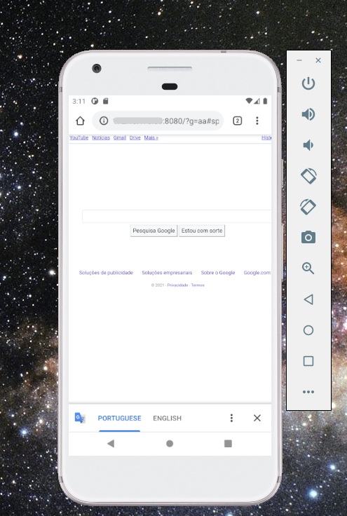

# local-proxy-emulator

Proxy local em Node.js criado para facilitar testes com o emulador do Android Studio.

Ele ajuda quando uma aplicacao rodando no emulador precisa acessar um dominio ou host configurado na maquina Windows, mas o emulador nao consegue resolver esse endereco diretamente.

## Problema

Durante o desenvolvimento mobile, e comum apontar APIs locais para dominios configurados no host, como:

```text
http://abc-doleta.com
```

Mesmo que esse dominio esteja funcionando na maquina Windows, o Android Emulator pode nao enxergar o mesmo mapeamento. Este projeto cria uma ponte simples: o emulador acessa o IP da maquina em uma porta local, e o proxy encaminha a requisicao para a URL base configurada.

## Como funciona

O servidor recebe requisicoes em uma porta local e repassa metodo, query string, body e cookies para a URL base informada.

Fluxo resumido:

```text
Android Emulator -> IP da maquina Windows:PORTA -> local-proxy-emulator -> URL_BASE
```

## Como rodar

Instale as dependencias:

```bash
npm install
```

Inicie o proxy informando a porta local e a URL base:

```bash
node index.js [PORTA] [URL_BASE]
```

Exemplo:

```bash
node index.js 3000 http://abc-doleta.com
```

Depois disso, configure o app no emulador para acessar o IP da sua maquina Windows na porta escolhida.

## Exemplo de uso

Se o IP da sua maquina na rede for `192.168.0.10` e voce iniciou o proxy na porta `3000`, o app no emulador pode chamar:

```text
http://192.168.0.10:3000
```

As requisicoes serao encaminhadas para:

```text
http://abc-doleta.com
```

## Stack

- Node.js
- Express
- Axios

## Observacoes

Este projeto foi criado como uma ferramenta simples de desenvolvimento local. Ele nao implementa recursos de seguranca, autenticacao ou controle de acesso para uso em producao.


